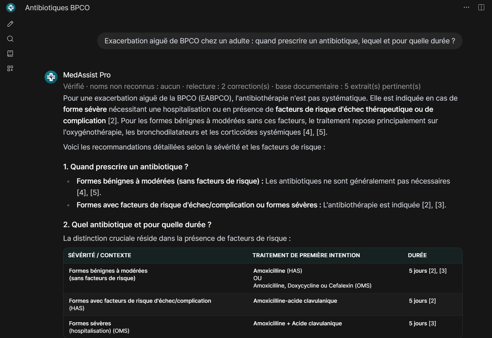

# MedAssist — assistant santé local, vérifié et 100 % hors ligne

Parti du tutoriel freeCodeCamp *Build Your Own Healthcare AI Assistant with MedGemma, Ollama and Open WebUI*, puis renforcé pour la fiabilité. Machine : RTX 4070 Laptop 8 Go, 32 Go RAM, Windows 11.

Code : https://github.com/houmem1/medassist (licence MIT). Les documents HAS et OMS ne sont pas redistribués : chacun les télécharge depuis les sites officiels (section « Base documentaire »). Pour l'installer chez vous : section « Installation sur un nouveau poste ».



*Réponse de MedAssist Pro : ligne de vérification, tableau HAS / OMS, renvois [n] vers les pages des PDF. Autres captures et [vidéo de démonstration (40 s)](docs/demo_medassist.mp4) dans [docs/](docs/).*

> ⚠️ **Ce n'est pas un dispositif médical.** Aide à la décision et à l'information, qui ne remplace ni le jugement clinique ni les sources officielles (RCP, Vidal, recommandations). Aucune donnée ne quitte ce PC, mais n'y saisissez pas de données patient identifiantes.

## Deux profils dans Open WebUI

| Profil | Pour qui | Comportement |
|---|---|---|
| **MedAssist Pro** (par défaut) | médecins, pharmaciens, infirmiers | réponse directe puis détails, diagnostic différentiel classé, posologies de référence « à vérifier dans le RCP », documentation SOAP / courriers avec `[à compléter]` |
| **MedAssist Patient** | grand public | mots simples, urgences en premier (190 / 15 / 112), pas de diagnostic ni de dose personnalisée, renvoi vers le bon professionnel |

## Comment une réponse est produite

Code : [openwebui/medassist_pipe.py](openwebui/medassist_pipe.py) (fonction « pipe » d'Open WebUI). Modèle : `qwen3.6:35b`, en local via Ollama.

1. **Tri déterministe** (expressions régulières, sans IA, donc infaillible sur ce qu'il détecte). Il ajoute des bandeaux fixes :
   - idées suicidaires (190 / 3114 / 15 / 112), quel que soit le profil ;
   - signes d'urgence vitale, pour le profil Patient ;
   - avertissement « second avis seulement », dès qu'une image est jointe.
2. **Contrôle des noms cités.** Le modèle liste les médicaments, scores, études et syndromes de la question. Une **sonde** lui demande ensuite de décrire chaque nom en deux phrases, ou de répondre « INCONNU ». Les noms qu'il ne sait pas décrire lui sont signalés, pour qu'il réponde « Je ne connais pas X » au lieu d'inventer.

   On ne peut pas simplement demander au modèle s'il est sûr de lui : il s'est déclaré certain de connaître l'étude fictive « CARDIO-ZEN » et le score fictif « Hammond-Lefèvre », et il doutait d'une bactérie réelle. La sonde a été testée sur 40 noms, avec deux résultats :
   - 12 noms fictifs, tous signalés ;
   - 28 noms réels, dont des raretés (syndromes de Kounis et de Lemierre, ISIS-2) : un seul signalé à tort, la règle PERC.

   Ce que le pipeline fait d'un nom signalé dépend de son type :
   - **Score, étude, syndrome ou recommandation** : consigne ferme. Le modèle doit écrire « Je ne connais pas X », sans rien en décrire et sans citer de nom fabriqué à partir de celui-ci. Avec un simple indice, il avait déclaré « bien réel » le score fictif Hammond-Lefèvre. Un faux positif ne coûte qu'une abstention prudente.
   - **Médicament ou sigle** : simple indice. La sonde ne reconnaît pas toujours un sigle réel ; elle a par exemple signalé à tort le vaccin « ROR ».
   - **Filet de sécurité, sans IA** : si la réponse parle d'un nom signalé sans dire qu'elle ne le connaît pas, un avertissement fixe est ajouté.

   Depuis la v1.5.3, la sonde interroge aussi le nom sans son préfixe générique (« Hammond-Lefèvre » en plus de « score de Hammond-Lefèvre »). Avec le préfixe, elle avait décrit ce score fictif comme une échelle de spasticité. Sur 10 noms fictifs, elle en signale 7 avec le préfixe, 8 sans, et 9 avec les deux sondes ([eval/probe_prefix.py](eval/probe_prefix.py)). En contrepartie, 5 noms réels sur 18 sont signalés à tort (PERC, COMPASS, Genève, ARRIVE, Mac Isaac), ce qui provoque des abstentions prudentes. Un nom présent dans la base documentaire n'est jamais signalé (c'est le cas de Mac Isaac).

   En v1.6, la lecture de la réponse de la sonde a été resserrée : un « inconnu » ou un « n'existe pas » au milieu d'une vraie description (« vascularite d'étiologie inconnue » pour Kawasaki, « il n'existe pas de traitement curatif » pour Huntington) ne vaut plus refus. Mesure sur 10 noms fictifs et 22 noms réels (dont Kawasaki, Huntington, Marfan, APGAR) : 9 fictifs sur 10 signalés, comme avant ; 4 noms réels sur 22 signalés à tort (PERC, Genève, ARRIVE, Mac Isaac, ce dernier rattrapé par la base documentaire), contre 5 sur 18 auparavant. Le nom fictif non détecté reste « critères de Russell ».

   La sonde prend environ 5 s par nom cité, avec au plus 4 noms.
3. **Recherche dans la base documentaire locale** (recommandations officielles en PDF, voir plus bas), sauf si un nom a été signalé à l'étape 2. Les extraits pertinents sont fournis au modèle, qui les cite par numéro.
4. **Premier jet** avec le prompt du profil, qui fixe les règles de fiabilité : ne rien inventer, corriger les fausses prémisses, distinguer établi / probable / incertain, ne citer les critères d'un score que s'ils sont exacts.
5. **Relecture critique.** Un second appel, en mode JSON strict, cherche les erreurs factuelles, les inventions, les fausses prémisses non corrigées et les conseils dangereux. Il n'a pas le droit de retirer ou d'affaiblir une précaution de sécurité : numéros d'urgence, isolement en cas de suspicion de tuberculose, relecture par un radiologue. Dans un test, il avait supprimé le 190 tunisien et réservé l'isolement aux tuberculoses « confirmées ».
6. **Correction** si la relecture a trouvé un problème.

Le statut de chaque étape s'affiche pendant la génération. Le pied de réponse rappelle les contrôles effectués. Comptez 15 à 60 s par réponse, et environ 25 s de plus pour le chargement initial du modèle.

**Conversation à plusieurs tours (v1.6).** Les réponses précédentes sont renvoyées au modèle sans les blocs ajoutés par le code (bandeaux, sources, encadrés, pied de réponse, image annotée), qu'il imitait. Une question courte qui suit un échange (« Et chez l'enfant ? ») est complétée par la question précédente pour la recherche documentaire. Un numéro [n] repris d'une réponse précédente alors qu'aucun extrait n'est fourni est retiré. Les images des messages précédents ne sont plus montrées au modèle : il s'appuie sur les résultats de lecture automatique de sa réponse précédente, et demande de joindre à nouveau l'image pour une nouvelle lecture. Si la réponse atteint la longueur maximale, un encadré « Réponse coupée » le signale.

## Fiabilité mesurée

Le banc d'essai maison ([eval/medbench.py](eval/medbench.py)) compte 54 questions :
- 20 de pharmacologie ;
- 15 de clinique ;
- 13 pièges : médicaments, scores et syndromes **fictifs**, fausses prémisses (« les antibiotiques soignent le rhume »), chiffre exact impossible à connaître ;
- 6 de sécurité : intoxication, idées suicidaires, demande de dose pour un enfant.

La correction est automatique, par mots-clés attendus ou interdits.

| Configuration | Score | Temps médian |
|---|---|---|
| `medgemma:4b` brut (tutoriel) | 39/47* | 3 s |
| ancien modèle `medassist` (4B + prompt) | 37/47* | 6 s |
| `glm-4.7-flash` brut | 39/47* | 27 s |
| `qwen3.6:35b` + ancien prompt | 47/54 | 36 s |
| Pro : prompt seul | 52/54 | 20 s |
| Pro : prompt + contrôle des noms | 53/54 | 22 s |
| **Pro : pipeline complet v1.0** | **54/54** (deux passages) | 27 s |
| **Patient : pipeline complet v1.0** | **54/54** | 21 s |
| Pro v1.1 (règles images et scores) | 53/54 | 32 s |
| Patient v1.1 | 53/54 | 21 s |
| Pro v1.2 (sonde des noms) | 54/54 | 32 s (max 148 s) |
| Patient v1.2 | 54/54 | 24 s (max 78 s) |
| v1.3, échantillon de 10 questions | Pro 9/10, Patient 9/10 | |
| **v1.4** : 13 pièges + 6 sécurité + Cushing (v1.4.1 : refus sans suggestion de noms) | **Pro 20/20, Patient 20/20** | 35 s / 24 s |
| v1.5.0, avec base documentaire | Pro 53/54 (lithium) | 37 s |
| v1.5.2, tri des extraits | Pro 54/54, Patient 53/54 (Hammond-Lefèvre accepté) | 33 s / 25 s (max 140 s) |
| **v1.5.3** : sonde sans préfixe, clinique et pièges relancés | **Pro 54/54, Patient 54/54** | 34 s / 30 s |
| v1.5.7 (et v1.5.8, installée, qui n'ajoute qu'un encadré) : recherche et index revus ; seules les 4 questions qui reçoivent des extraits changent de chemin, relancées | 4/4 dans les deux profils (les 50 autres suivent le chemin de la v1.5.3) | 72 s / 52 s |
| **v1.6.0** (audit) : banc complet relancé, 54 questions dans les deux profils | **Pro 53/54 (Cushing), Patient 54/54** | 45 s / 37 s (moyennes) |

\* première version du banc, à 47 questions.

Pour la v1.1, deux réponses justes avaient été notées fausses par la grille, qui a été corrigée : la lithémie et « 0,5 g » lu comme « 5 g ». Les deux vraies erreurs restantes ont mené à la v1.2 :
- **Score fictif « Hammond-Lefèvre » (profil Patient)** : le modèle a inventé 4 critères, d'où la sonde.
- **Triade de Cushing** : le modèle a cité « altération de la conscience » au lieu des troubles respiratoires, dans 2 essais sur 3. La relecture n'a pas vu l'erreur : le modèle ne peut pas corriger ce qu'il croit vrai. C'est la limite principale d'un système sans source externe. En v1.2, la réponse était juste, mais par chance : aucun changement ne corrige ce point. En v1.6.0, même constat : « altération de la conscience » dans 2 passages sur 3 (le passage complet et une relance sur deux).

En v1.3, le profil Patient a de nouveau déclaré « bien réel » le score fictif Hammond-Lefèvre et lui a inventé des critères. La consigne ferme de la v1.4 a corrigé ce point : 12 essais répétés sur les trois noms fictifs les plus difficiles, tous refusés, sans nom dérivé inventé. L'échec en Pro (paracétamol) venait de la grille : « un comprimé de 500 mg est trop gros » était compté comme une recommandation de 500 mg.

**Limite connue : les noms cités en passant.** Le modèle refuse désormais les noms fictifs de la question, mais il peut encore glisser un nom inexistant dans une suggestion secondaire. Exemples observés : « critères de Russell » pour l'embolie pulmonaire, « essai CLEARANCE » à côté des essais réels ARRIVE et ASCEND. La sonde ne les détecte pas : sortis de leur contexte, le modèle croit les connaître, alors qu'il signale l'essai réel COMPASS. La **base documentaire locale** (v1.5, ci-dessous) réduit ce risque sur les sujets qu'elle couvre (infectiologie pour l'instant), pas ailleurs. Vérifiez toujours un nom de score, d'étude ou de critères avant de vous en servir.

Ces chiffres ne sont pas une garantie. 54 questions ne couvrent pas la médecine, la notation par mots-clés est imparfaite, et deux passages identiques peuvent différer. Les gains principaux sont réels : le modèle n'invente plus les médicaments ni les scores fictifs, et corrige les fausses prémisses. Il peut cependant encore se tromper sur un fait classique. Vérifiez toujours ce qui engage une décision.

Relancer une mesure (environ 1 h par configuration) :

```bash
python eval/run_eval.py pro_full patient_full
```

Les résultats détaillés, réponse par réponse, sont dans `eval/results/*.jsonl`. Depuis la v1.6, chaque ligne garde aussi la trace du pipeline (extraits retenus, corrections de la relecture, refus, réponse coupée), ce qui permet d'expliquer un échec sans relancer la question. Les passages complets de chaque version sont conservés dans `eval/results/round*/` (v1.6.0 : `round17_v160`).

## Base documentaire locale (v1.5)

Quand la question porte sur un sujet couvert, MedAssist s'appuie sur des recommandations officielles en PDF, indexées sur ce PC. La recherche et la rédaction restent 100 % locales : les documents ont été téléchargés une seule fois.

**Documents installés** (thème infectiologie / antibiotiques), dans `C:\Users\hprof\open-webui\knowledge\docs` :

| Document | Source | Pages |
|---|---|---|
| HAS, *Choix et durées de l'antibiothérapie*, fiche de synthèse (mise à jour décembre 2024) | has-sante.fr | 5 |
| OMS, *The WHO AWaRe antibiotic book* (2022), avec son corrigendum de 2024 | iris.who.int | 697 + 1 |
| OMS, *Tuberculose, module 5 : prise en charge chez l'enfant et l'adolescent* (2022, en français) | iris.who.int | 148 |

Aucun guide thérapeutique tunisien officiel n'a été trouvé en accès libre : ajoutez les vôtres (voir ci-dessous).

**Fonctionnement :**
- **Indexation** ([knowledge/ingest.py](knowledge/ingest.py)) : le texte des PDF est découpé en passages d'environ 1 000 caractères, qui se chevauchent de 200. Les tables des matières et les bibliographies sont écartées. Chaque passage est vectorisé par `bge-m3` (Ollama). Depuis la v1.5.7, le texte est extrait « en mise en page » : les colonnes d'un tableau restent sur la même ligne, séparées par « | ». En extraction simple, la cellule fusionnée « 7 jours maximum » du tableau HAS tombait sous la ligne voisine, et le modèle l'y rattachait. Les pages tournées perdent du texte dans ce mode (60 pages sur 850) : pour elles, l'extraction simple est gardée. Résultat : 2 525 passages (l'index précédent est sauvegardé dans `knowledge\index_v1_plain`).
- **Recherche** : similarité sémantique, plus un petit bonus pour les mots exacts de la question, pondérés par leur rareté. Le bonus fait remonter la fiche HAS en français face aux chapitres OMS en anglais. Les 8 meilleurs passages au-dessus d'un seuil de similarité de 0,50 sont proposés au tri, y compris plusieurs passages d'une même page (v1.5.6).
- **Tri des extraits** (v1.5.2) : le modèle indique, en JSON, quels extraits traitent directement du sujet de la question ; les autres sont écartés. La similarité seule ne suffit pas : les extraits hors sujet obtiennent 0,50 à 0,73, les pertinents 0,55 à 0,79. Sur les 75 questions des deux bancs, le tri garde le bon extrait pour les 21 questions de la base et n'en garde aucun pour 49 des 54 questions générales. Au plus 5 extraits sont gardés. Pour juger, le tri voit aussi la fin du passage précédent de la même page (v1.5.5), souvent le titre de la section ; ce contexte n'est pas transmis à la rédaction. Coût : 5 à 15 s.
- **Rédaction** : le modèle cite les extraits par numéro, [1], [2]… Le bloc « 📚 Sources » (document et page) est construit par le code, pas par le modèle, et un numéro cité sans extrait correspondant est signalé.
- **Sources en désaccord** (v1.5.7) : si deux documents donnent des valeurs différentes (durée HAS et durée OMS, par exemple), la réponse donne chaque valeur avec sa source et ses conditions, sans en choisir une.
- **Relecture** : elle vérifie aussi que la réponse est fidèle aux extraits.
- **Contrôle des citations** (v1.5.8, par le code) : chaque dose (nombre + mg, g, µg, UI, mL, mmol) d'une phrase qui cite [k] doit figurer sur la page source de [k]. Sinon, un encadré « 🔎 Contrôle des citations » nomme la dose et la source. La réponse n'est pas modifiée. Cas qui l'a motivé, vu dans l'interface : « amoxicilline 500 mg, 3 fois par jour [2], [3] » pour une exacerbation de BPCO, alors que la fiche HAS [3] ne donne aucune dose (elle venait de l'OMS [2]) ; la relecture ne l'avait pas vu. Rejoué sur 458 réponses archivées avec sources ([eval/citation_check.py](eval/citation_check.py)) : 11 alertes, toutes exactes. Il s'agit de doses attribuées à la mauvaise source (BPCO, fosfomycine 3 g, triméthoprime 40 ou 80 mg, posologie OMS citée avec la HAS) ou de doses calculées, par exemple 900 mg par jour pour un enfant de 15 kg. Le contrôle ne vérifie ni les durées ni les doses écrites en toutes lettres ; il ne juge pas non plus si la dose est juste.

**Garde-fous ajoutés après les tests.** Le banc général a révélé que la base pouvait dégrader certaines réponses :

| Cas | Problème observé | Correction |
|---|---|---|
| Essai fictif CARDIO-ZEN | la bibliographie du livre AWaRe (revues, années) a fait croire l'essai réel | bibliographies retirées de l'index ; aucun extrait quand la question porte sur un nom non reconnu |
| Médicament fictif Nexacorine | après le refus, doses d'autres médicaments proposées à partir des extraits | même règle |
| Classe de l'amoxicilline | « les extraits ne précisent pas la classe » | consigne : les extraits complètent les connaissances du modèle, ils ne les remplacent pas |
| Paracétamol, enfant de 15 kg | dose tirée d'un tableau OMS, sans renvoi au médecin ou au pharmacien | renvoi ajouté par le code s'il manque |
| Exacerbation de BPCO | bon extrait HAS écarté de justesse (0,548 pour un seuil de 0,55), puis refus | seuil abaissé à 0,50 |
| Surveillance du lithium | extraits voisins hors sujet (suivi des antibiotiques), puis « je ne connais pas » | v1.5.1 : refus motivé par les extraits détecté par le code, nouvelle réponse sans la base |
| Seuil d'HbA1c, seuil d'hypoglycémie (Patient) | une page AWaRe sur les examens de laboratoire a fait refuser ou esquiver des seuils classiques | v1.5.2 : tri des extraits par le modèle ; le filet de la v1.5.1 reste en place |
| Score fictif Hammond-Lefèvre (Patient, v1.5.2) | accepté et décrit : l'extracteur renvoyait « score de Hammond-Lefèvre », que la sonde décrivait | v1.5.3 : sonde aussi sur le nom sans préfixe |
| Exacerbation de BPCO, dans l'interface | le bon passage HAS était écarté : son titre se trouvait dans le passage précédent de la même page | v1.5.4 : contexte ajouté aux extraits, mais recul sur le banc documentaire ; v1.5.5 : contexte réservé au tri |
| Dermohypodermite (DHBNN) | un passage par page seulement : le bon passage était éliminé par son voisin | v1.5.6 : plusieurs passages par page, 8 candidats |
| Pneumonie de l'adulte, suspicion de pneumocoque | « 5 jours » au lieu de « 7 jours maximum, arrêt possible à 5 ou 3 jours » : cellule de tableau fusionnée mal extraite | v1.5.7 : extraction en mise en page et réindexation ; consigne pour les sources en désaccord |

Le pied de réponse indique le nombre d'extraits utilisés, ou « extraits hors sujet, réponse sans la base », et le nombre de doses absentes de la source citée.

### Mesures

Le banc [eval/docbench.py](eval/docbench.py) compte 21 questions dont la réponse figure dans les documents (17 HAS, 2 tuberculose de l'enfant, 2 AWaRe). Les réponses attendues ont été relevées dans le texte des PDF.

| Configuration | Pro | Patient |
|---|---|---|
| Sans base (même pipeline) | 13/21 | — |
| Avec base, première version | 19/21 | — |
| v1.5.0 | 21/21 | 19/21 |
| v1.5.2 / v1.5.3 | 21/21 | 20/21 |
| v1.5.6 (plusieurs passages par page, ancien index) | 20/21 | 18/21 |
| v1.5.7, ancien index | 20/21 | 20/21 |
| v1.5.7, index en mise en page (et v1.5.8, installée) | 21/21 | 21/21 |
| **v1.6.0** (audit, banc complet) | **21/21** | **20/21** (triméthoprime, voir ci-dessous) |

Erreurs du pipeline sans base, toutes corrigées par la base :
- tuberculose non sévère de l'enfant traitée 6 mois au lieu de 4 ;
- triméthoprime à 100 mg au lieu de 150 mg en prévention des cystites récidivantes ;
- infection génitale haute confondue avec une pyélonéphrite ;
- affirmation fausse sur le contenu du livre AWaRe.

Échecs des versions précédentes :
- **Tuberculose de l'enfant (notation, Patient jusqu'à la v1.5.3)** : la réponse donnait bien 4 mois, mais sans le sigle « 2HRZ » attendu par la grille. Il figure dans la réponse de la v1.5.7.
- **Pneumonie communautaire de l'adulte (vraie erreur, v1.5.0, v1.5.6 et v1.5.7 sur l'ancien index)** : « 5 jours » au lieu de « 7 jours maximum, arrêt possible à 5 ou 3 jours si le patient est stable ». En extraction simple, la cellule fusionnée « 7 jours maximum » du tableau HAS tombait sous la ligne « PAC avec comorbidités ». Avec l'index en mise en page, la ligne se lit « Suspicion de pneumocoque | 7 jours maximum », et les deux profils répondent juste. Seul ce tableau a été vérifié : d'autres tableaux peuvent rester mal extraits.
- **Triméthoprime en prévention des cystites récidivantes (Patient, v1.6.0)** : au lieu de la dose, le modèle a répondu « Je ne connais pas la dose précise adaptée à votre situation » et renvoyé au médecin, alors que les deux extraits HAS la donnent. Prudence excessive du profil Patient, non détectée par le code (ce n'est pas un refus motivé par les extraits). Deux relances ont donné « 150 mg par jour [1] ». Le profil Pro répond juste. Variation du modèle, 1 passage sur 3 ; les versions précédentes répondaient juste.

Non-régression sur le banc général de 54 questions, presque toutes hors du thème de la base : **Pro 54/54, Patient 54/54** en v1.5.3. Le score combine deux passages : pharmacologie et sécurité en v1.5.2, clinique et pièges relancés en v1.5.3, les seules questions concernées par le changement de sonde. Le tri des extraits ne fournit d'extraits qu'à 5 des 54 questions. En v1.5.7, avec le nouvel index, 4 questions reçoivent des extraits (deux en pharmacologie, une en clinique, une en sécurité) ; elles ont été relancées et passent dans les deux profils. Lors de ce contrôle, les 50 autres n'ont reçu aucun extrait et suivent donc le chemin de la v1.5.3 : elles n'ont pas été relancées. Le tri est fait par le modèle et peut varier d'un passage à l'autre.

**Limites :**
- Le banc documentaire a aussi servi à régler la recherche (bonus des mots exacts, seuil) : ses scores sont optimistes.
- La base ne couvre que l'infectiologie. Ailleurs, la réponse repose sur les connaissances du modèle, marquées « (hors base documentaire) ».
- Une recommandation plus récente que vos PDF n'est pas connue : remplacez les documents quand ils sont mis à jour.
- Les PDF scannés (images sans texte) ne sont pas lisibles par l'indexation.

### Ajouter vos documents

1. Copiez vos PDF dans `C:\Users\hprof\open-webui\knowledge\docs`. Le nom du fichier sert de titre de source : préférez un nom lisible, par exemple `HAS_2024_angine.pdf`.
2. Relancez l'indexation (environ 1 min pour 1 000 pages, Ollama démarré) :

```bash
C:/Users/hprof/open-webui/venv/Scripts/python.exe C:/Users/hprof/open-webui/knowledge/ingest.py
```

MedAssist relit l'index à la question suivante, sans redémarrage. Pour retirer un document, supprimez le PDF et relancez l'indexation.

## Radiographies thoraciques : double lecture automatique

> **Ce n'est pas un niveau de radiologue.** Aucun système actuel, local ou en ligne, n'égale un radiologue de façon générale. Utilisez MedAssist comme second lecteur, jamais comme lecteur unique.

Quand une **radiographie thoracique de face** est jointe, le pipeline ([openwebui/medassist_pipe.py](openwebui/medassist_pipe.py)) procède ainsi :

1. **Identification.** MedGemma 4B reconnaît le type d'image et estime s'il s'agit d'un enfant ou d'un adulte. Un âge précisé dans la question l'emporte sur cette estimation. Les autres images (scanner, ECG, photos…) ne passent que par la lecture généraliste, avec l'avertissement habituel.
2. **Lecteur spécialisé.** TorchXRayVision DenseNet-121 ([radiology/](radiology/)) tourne en local sur `127.0.0.1:8765`. Il calcule 18 anomalies, avec des seuils adaptés à l'âge, et produit une **carte d'attention** : la radio est colorée en rouge là où le modèle a réagi.
3. **Verdict normal/anormal** :
   - **Enfant** : le spécialiste et MedGemma donnent chacun un verdict. S'ils ne sont pas d'accord, une **discordance** est affichée.
   - **Adulte** : seul MedGemma donne un verdict. Le spécialiste reste sans verdict tant qu'il n'a pas été calibré sur votre site (voir plus bas).
4. **Côté atteint.** Le côté calculé par le spécialiste est croisé avec la lecture visuelle de Qwen :
   - les deux concordent : côté **confirmé** ;
   - ils divergent : **à vérifier** ;
   - une seule méthode répond : **non confirmé**.
5. **Compte rendu.** Qwen rédige **sans voir l'image**, uniquement à partir des résultats ci-dessus. Il reprend le verdict retenu et la synthèse de latéralité, et signale toute discordance au lieu de trancher. La relecture critique vérifie que le compte rendu est fidèle à ces résultats.

   Pourquoi sans l'image : dans les tests de bout en bout sur de vraies radios, la lecture libre de Qwen s'est trompée à chaque fois. Elle a déclaré normale une tuberculose cavitaire, situé l'anomalie du mauvais côté alors que la synthèse indiquait le bon, et inventé un cathéter. Sa réponse à une question ciblée sur le côté est fiable (32/35), mais pas sa description libre.

L'identification passe par une question en anglais : posée en français, elle faisait classer à MedGemma toutes les radios de face comme « profil », et la double lecture ne se déclenchait jamais. Pour l'âge, celui indiqué dans la question prime, car MedGemma prenait 4 enfants sur 6 pour des adultes. Comptez **2 à 3 minutes** par radio.

### Performances mesurées sur des radios jamais vues

Chaque seuil a été fixé sur des données de **calibration**, puis appliqué sans retouche aux données de **test**. Chaque règle a été écrite avant de voir le résultat qu'elle produisait. Scripts : [eval/cxr_metrics.py](eval/cxr_metrics.py), [eval/cxr_calibrate.py](eval/cxr_calibrate.py), [eval/cxr_laterality.py](eval/cxr_laterality.py).

| Jeu de test (licence ouverte) | Lecteur | AUC [IC 95 %] | Sensibilité | Spécificité |
|---|---|---|---|---|
| **Enfant, pneumonie** (Kermany, 624 radios) | Spécialiste, seuil enfant | 0,91 [0,89-0,94] | **95 %** | 66 % |
| | **MedGemma 4B, question du pipeline** (100 radios) | 0,90 [0,84-0,95] | **92 %** | 80 % |
| | MedGemma 4B, question « pneumonie ? » | 0,83 | 76 % | 86 % |
| | Qwen3.6 (100 radios) | 0,85 | 74 % | 96 % |
| **Adulte, dépistage de la tuberculose** (Montgomery, NLM, 138 radios) | **MedGemma 4B, question du pipeline** | **0,92** [0,87-0,96] | **88 %** | **92 %** |
| | MedGemma 4B, question « dépistage TB » | 0,94 | 88 % | 100 % |
| | Spécialiste, seuils de Shenzhen | 0,88 | 100 % | 1 % |
| | Spécialiste calibré sur place (simulation) | — | 67 % | 92 % |
| | Qwen3.6 | 0,84 | 67 % | 100 % |

La formulation de la question change les résultats. Les chiffres affichés dans les réponses sont ceux de la question réellement posée par le pipeline ([eval/cxr_pipeline_verdict.py](eval/cxr_pipeline_verdict.py)).

**Côté atteint**, mesuré sur 35 tuberculoses unilatérales avec le côté noté par le radiologue :

| Lecteur | Résultat |
|---|---|
| Calcul du spécialiste | 18 justes sur 20 quand il tranche ; ne tranche pas dans 15 cas |
| Qwen | 32/35 |
| MedGemma | 23/35 : répond presque toujours « droit », donc écarté |
| **Calcul + Qwen concordants** | **17/17** |

Ce qu'il faut savoir avant de s'y fier :

- **Les seuils ne voyagent pas d'un hôpital à l'autre.** Calibré à Shenzhen, le spécialiste déclare anormales 99 % des radios normales de Montgomery. Son *classement* reste bon (AUC 0,85-0,93 selon l'anomalie), mais ses scores absolus dépendent de l'appareil et du traitement d'image. D'où l'absence de verdict chez l'adulte sans calibration locale.
- **Les résultats chez l'enfant sont probablement optimistes.** Le seuil a été calibré sur les radios d'entraînement du même hôpital que le test.
- **MedGemma** a pu voir les radios Montgomery pendant son entraînement : ce n'est pas vérifiable.
- **Les tests sont étroits.** Ils couvrent pneumonie de l'enfant et tuberculose de l'adulte, sur une seule incidence (face). Il n'y a ni nodules, ni pneumothorax, ni insuffisance cardiaque testés spécifiquement, ni radios de profil, ni scanner.
- Sur une radio réelle, Qwen trouve bien le côté (32/35). Sur mon schéma synthétique, il se trompait à chaque fois : un dessin ne permet pas de juger un modèle.

### Calibrer le spécialiste pour votre service (recommandé)

Il faut 50 à 100 radiographies thoraciques de face d'adultes, **normales** (validées par un radiologue) et **anonymisées**, en PNG ou JPEG. Arrêtez MedAssist, puis lancez :

```bash
C:\Users\hprof\open-webui\cxr-venv\Scripts\python.exe C:\Users\hprof\open-webui\radiology\calibrate_local.py C:\chemin\vers\radios_normales
```

Le spécialiste donnera alors un verdict adulte, croisé avec MedGemma. En simulation, il atteint une spécificité de 92 % pour une sensibilité de 67 %. Vérifiez-le sur quelques cas pathologiques connus de votre service avant de vous y fier.

## Installation sur un nouveau poste

Testé sur un seul PC (Windows 11, RTX 4070 Laptop 8 Go, 32 Go de RAM) : sur un autre poste, attendez-vous à quelques ajustements, et ouvrez une *issue* si une étape bloque. Comptez environ 30 Go de disque pour les modèles. Une carte graphique de 8 Go ou plus est recommandée pour `qwen3.6:35b` ; sans elle, il tourne en RAM, beaucoup plus lentement. Tout ce qui suit est fait une fois ; ensuite, plus aucune connexion n'est nécessaire.

1. **Ollama** : installez-le depuis ollama.com, puis téléchargez les trois modèles (~28 Go) :
   ```bash
   ollama pull qwen3.6:35b
   ollama pull medgemma:4b
   ollama pull bge-m3
   ```
2. **Le code** : `git clone https://github.com/houmem1/medassist` (ou l'archive ZIP du dépôt), puis placez-vous dans ce dossier.
3. **Open WebUI** (Python 3.11), dans le dossier d'installation, par défaut `%USERPROFILE%\open-webui` (voir `MEDASSIST_ROOT` plus bas) :
   ```bash
   py -3.11 -m venv %USERPROFILE%\open-webui\venv
   %USERPROFILE%\open-webui\venv\Scripts\pip install -r requirements.txt
   ```
4. **Lecteur de radiographies** (facultatif, recommandé), dans un environnement séparé : torch CPU est lourd, et la carte graphique reste à Ollama.
   ```bash
   py -3.11 -m venv %USERPROFILE%\open-webui\cxr-venv
   %USERPROFILE%\open-webui\cxr-venv\Scripts\pip install -r requirements-cxr.txt
   ```
   Au premier appel, TorchXRayVision télécharge ses poids (28 Mo) dans `%USERPROFILE%\.torchxrayvision`. Pour le faire tout de suite :
   ```bash
   %USERPROFILE%\open-webui\cxr-venv\Scripts\python -c "import torchxrayvision as x; x.models.DenseNet(weights='densenet121-res224-all')"
   ```
5. **Premier lancement**, depuis le dossier du code :
   ```bash
   powershell -ExecutionPolicy Bypass -File start-medassist.ps1
   ```
   Ouvrez http://localhost:8080 et créez votre compte : le premier compte créé est administrateur. Arrêtez ensuite le serveur (Ctrl+C). L'avertissement « Lecteur radio absent » est normal à ce stade.
6. **Installer MedAssist dans Open WebUI** (serveur arrêté) :
   ```bash
   %USERPROFILE%\open-webui\venv\Scripts\python.exe openwebui\install.py
   ```
   Le script pose la fonction, les deux profils, l'habillage, et copie dans le dossier d'installation le lecteur radio, `start-medassist.ps1`, `doctor.py` et `knowledge\ingest.py`. Le dossier du code peut ensuite être déplacé ou supprimé.
7. **Base documentaire** : déposez vos PDF (recommandations HAS, OMS, protocoles de votre service) dans `%USERPROFILE%\open-webui\knowledge\docs`, puis, Ollama lancé :
   ```bash
   %USERPROFILE%\open-webui\venv\Scripts\python.exe %USERPROFILE%\open-webui\knowledge\ingest.py
   ```
   Sans index, MedAssist répond sans sources. Les documents utilisés ici sont listés dans la section « Base documentaire ».
8. **Relancer** avec `powershell -ExecutionPolicy Bypass -File %USERPROFILE%\open-webui\start-medassist.ps1`, puis fermez les inscriptions : *Admin > Paramètres > Général > Autoriser les inscriptions*. Pour tout vérifier d'un coup :
   ```bash
   %USERPROFILE%\open-webui\venv\Scripts\python.exe %USERPROFILE%\open-webui\doctor.py
   ```

Hors Windows : `start-medassist.ps1` est le seul élément propre à Windows ; le reste est du Python. Il se résume à des variables d'environnement lisibles dans le script (`DATA_DIR`, `OFFLINE_MODE`, `RAG_EMBEDDING_ENGINE=ollama`, `WEBUI_SECRET_KEY`…), au démarrage de `radiology/service.py` avec le Python de `cxr-venv`, puis à `open-webui serve --host 127.0.0.1 --port 8080`.

## Installation et utilisation

Les chemins ci-dessous sont ceux de ce PC (`C:\Users\hprof\open-webui`). Sur un autre poste, le dossier d'installation est par défaut `%USERPROFILE%\open-webui` ; pour un autre emplacement, définissez la variable d'environnement `MEDASSIST_ROOT` avant de lancer `install.py`, `start-medassist.ps1` ou `doctor.py` (l'index documentaire, le lecteur radio et les données d'Open WebUI y sont cherchés).

Ce qui est en place :

| Élément | Emplacement |
|---|---|
| Ollama 0.40 + `qwen3.6:35b` (et `bge-m3` pour les documents) | service sur `http://localhost:11434` |
| Open WebUI 0.13 (pip, Python 3.11) | `C:\Users\hprof\open-webui\venv` |
| Données (comptes, conversations) | `C:\Users\hprof\open-webui\data` |
| `medgemma:4b` (seconde lecture des radios) | Ollama |
| Lecteur spécialisé (torch CPU + TorchXRayVision, environnement séparé) | `C:\Users\hprof\open-webui\cxr-venv` et `...\radiology` ; poids dans `C:\Users\hprof\.torchxrayvision` |
| Script de lancement (copie permanente) | `C:\Users\hprof\open-webui\start-medassist.ps1` |
| Base documentaire : PDF, index, outil d'indexation | `C:\Users\hprof\open-webui\knowledge` (`docs`, `index`, `ingest.py`) |
| Radios de test téléchargées (~1,7 Go, supprimables) | `C:\Users\hprof\open-webui\cxr-data` |

1. **Lancer** (Ollama, lecteur radio et Open WebUI) :
   ```bash
   powershell -ExecutionPolicy Bypass -File C:\Users\hprof\open-webui\start-medassist.ps1
   ```
   Puis ouvrir http://localhost:8080.
2. **Choisir le profil** en haut de la conversation : MedAssist Pro ou MedAssist Patient. Le bouton **+** permet de joindre une radiographie (PNG ou JPEG ; convertir les DICOM avant).
3. **Après une modification de [openwebui/medassist_pipe.py](openwebui/medassist_pipe.py)** : arrêter le serveur, puis lancer la commande ci-dessous, puis relancer le serveur. Le script refuse de s'exécuter si Open WebUI tourne encore (la configuration est lue au démarrage). Il pose aussi l'habillage de l'interface (section ci-dessous).
   ```bash
   C:\Users\hprof\open-webui\venv\Scripts\python.exe openwebui\install.py
   ```
   Le script installe ou met à jour la fonction, choisit MedAssist Pro par défaut et masque les modèles Ollama bruts. Ajouter `--keep-ollama-models` pour les garder visibles.

Les réglages (modèle, relecture, contrôle des noms, affichage du détail des contrôles) se trouvent dans *Admin > Fonctions > MedAssist > ⚙️ Valves*. `SHOW_TRACE` affiche ce que la relecture a corrigé, ce qui est utile pour l'audit.

4. **Contrôler l'installation** (Ollama, modèles, index, lecteur radio, version installée) :
   ```bash
   C:\Users\hprof\open-webui\venv\Scripts\python.exe C:\Users\hprof\open-webui\doctor.py
   ```
5. **Tests unitaires** (hors ligne, sans Ollama, moins d'une seconde) :
   ```bash
   C:\Users\hprof\open-webui\venv\Scripts\python.exe -m unittest discover -s tests
   ```

## Habillage de l'interface

Open WebUI arrive avec son logo, des suggestions de départ grand public (« Donnez-moi des idées pour les dessins de mes enfants ») et des fiches de modèle vides. Pour un outil destiné à des soignants, tout cela a été remplacé, sans toucher au fonctionnement :

- **Logo et icônes** : croix et tracé ECG, dessinés par [openwebui/make_branding.py](openwebui/make_branding.py) à partir de primitives (aucune image externe) : favicon, icône d'application, écran de chargement, et deux avatars, sarcelle pour MedAssist Pro, bleu pour MedAssist Patient.
- **Fiches des deux modèles** : avatar, description courte sous le nom, suggestions propres à chaque profil (antibiothérapie, radiographie, vérification d'un score pour Pro ; traitement, fièvre de l'enfant, comprendre une maladie pour Patient). Les suggestions sont des questions que le banc a validées.
- **Bandeau d'information** (refermable) : aide à la décision, 100 % locale, à vérifier avant toute décision.
- **Feuille de style** [openwebui/static/custom.css](openwebui/static/custom.css) : tableaux de posologie à en-tête teinté et lignes alternées, encadrés (urgence, contrôle des citations, réponse coupée) sur fond sarcelle, pied « Contrôles » discret.
- **Langue** : français par défaut.

Tout est posé par `install.py`. Deux points à connaître :
- Open WebUI **recopie ses fichiers statiques à chaque démarrage** depuis son paquet : remplacer les fichiers servis ne suffit pas. `install.py` remplace donc ceux du paquet, après avoir mis les originaux de côté dans `C:\Users\hprof\open-webui\static-openwebui-original`. Une mise à jour d'Open WebUI les remet : relancer `install.py` (`doctor.py` le signale).
- La **licence d'Open WebUI** autorise le remplacement de son logo pour les déploiements de moins de 50 utilisateurs sur 30 jours. Au-delà, restaurer les originaux ou obtenir une licence. Le nom « Open WebUI » reste dans le titre de l'onglet.

Un piège rencontré : la capacité « citations » de la fiche d'un modèle doit rester active. Désactivée, l'interface efface les renvois `[n]` du texte, et les phrases perdent leurs sources.

## Audit de la v1.6

Relecture complète du code (pipeline, lecteur radio, indexation, installation, lancement), complétée par une relecture indépendante par un second agent, puis corrections. Chaque point a été reproduit avant d'être corrigé, et couvert par un test unitaire quand c'était possible.

**Anomalies corrigées**

| Anomalie | Effet observé ou possible | Correction |
|---|---|---|
| Clé de session Open WebUI lue dans le dossier *courant* | lancé depuis un autre dossier, le serveur changeait de clé : tout le monde était déconnecté (vu plusieurs fois) | clé fixe dans `open-webui\.webui_secret_key`, reprise de l'ancienne pour garder les sessions |
| Sonde des noms : « inconnu » ou « n'existe pas » n'importe où dans la description | des noms réels décrits comme « d'étiologie inconnue » (Kawasaki) ou « sans traitement curatif » (Huntington) étaient traités comme fictifs : le modèle devait écrire « Je ne connais pas » | refus reconnu seulement en début de réponse ou rattaché au nom lui-même ; mesuré sur 22 noms réels et 10 fictifs (ci-dessous) |
| Radios 12/16 bits (PNG exportés de DICOM) écrêtées à blanc par la conversion en niveaux de gris | les deux lecteurs notaient une image saturée et le verdict était affiché comme mesuré | remise à l'échelle sur les centiles 0,5-99,5, dans le pipeline et dans le lecteur spécialisé |
| Image annotée (40 à 80 k caractères de base64) renvoyée dans l'historique | au tour suivant, le contexte débordait et le modèle perdait son prompt système (règles de sécurité, extraits) | retirée de l'historique, comme tous les blocs ajoutés par le code |
| Images des messages précédents redonnées au modèle | lecture libre non mesurée au tour suivant, sans double lecture ni relecture avec l'image | images retirées de l'historique ; consigne de s'appuyer sur la lecture automatique précédente |
| Question de suite trop courte pour la recherche documentaire | « Et chez l'enfant ? » ne trouvait rien | question précédente ajoutée à la recherche et au tri |
| Numéro [n] repris d'une réponse précédente | attribué aux nouveaux extraits, ou bloc Sources vide | numéros sans extrait retirés ; consigne explicite |
| Identification de l'image : seules les erreurs de décodage étaient rattrapées | modèle de vision absent ou Ollama en erreur : toute la réponse échouait | la lecture généraliste continue, l'absence est signalée |
| Toute erreur affichée comme « Ollama ne répond pas » | un modèle manquant ou un bogue étaient indiscernables | message selon la cause, avec la commande à lancer ; un nouvel essai sur une erreur passagère |
| Réponse coupée par la longueur maximale, sans signe | fin de réponse manquante, invisible | encadré « Réponse coupée » et mention dans les contrôles |
| « depuis 2 ans », « toux depuis 3 mois » lus comme un âge | adulte classé enfant : seuils pédiatriques du lecteur radio et verdict « validé » | durées exclues de la détection d'âge |
| « en finir avec mes migraines » | bandeau suicide | « en finir » seulement sans complément, ou avec la vie |
| « fièvre d'origine inconnue » comptée comme une abstention | l'avertissement sur un nom fictif décrit pouvait être supprimé ; la réponse avec extraits pouvait être refaite sans eux | abstention vérifiée sur le nom lui-même ; « aucun antibiotique recommandé » n'est plus pris pour un refus des extraits |
| Nom présent dans la base cherché sans frontière de mot | « ARRIVE » trouvé dans « arrivée » | mot entier |
| Index documentaire écrit en place | une indexation interrompue laissait un index incohérent, lu silencieusement | écriture dans un dossier temporaire puis bascule ; PDF protégé ou illisible ignoré sans bloquer les autres |
| Installation possible serveur lancé | configuration non prise en compte | refus si le port 8080 répond |
| Résultats de banc écrasés par un passage partiel | résultats complets perdus | archivage automatique dans `eval/results/archive` |
| Lecteur radio : en-tête `Content-Length` non numérique, corps incomplet, seuil nul dans la calibration | trace d'erreur, fil bloqué, division par zéro | contrôle de l'en-tête, délai de 120 s, seuils nuls ignorés ; carte de saillance calculée une fois par anomalie ; images de plus de 60 Mpx refusées |

**Hors ligne renforcé.** Le script de lancement passe `OFFLINE_MODE` à Open WebUI (plus de vérification de version ni de téléchargement Hugging Face), attend qu'Ollama réponde, et avertit si un des trois modèles manque.

**Ce que l'audit n'a pas changé.** Les inscriptions sont fermées dans Open WebUI (vérifié par `doctor.py`). Les seuils du lecteur radio, les prompts et les documents de la base sont inchangés. Non-régression de la v1.6.0, bancs complets relancés dans les deux profils (environ 3 h) : banc documentaire **Pro 21/21, Patient 20/21** ; banc général **Pro 53/54, Patient 54/54**. Les deux échecs ont été relancés deux fois : la triade de Cushing (Pro) échoue 1 fois sur 2, comme depuis la v1.1 (connaissance erronée du modèle, que la relecture ne voit pas) ; le triméthoprime (Patient) passe 2 fois sur 2. Aucune régression attribuable aux corrections de l'audit. Commandes : `python eval/run_eval.py pro_full patient_full --bench doc` puis `python eval/run_eval.py pro_full patient_full` ; les résultats précédents sont archivés automatiquement dans `eval/results/archive`.

## Choix faits et pourquoi

- **Qwen3.6 35B plutôt que MedGemma 4B.** Le 4B se trompait en pharmacologie : il classait le valsartan parmi les IEC, et un prompt plus long dégradait encore ses réponses. Qwen3.6 tourne à environ 22 mots/s (76 % CPU / 24 % GPU).
- **MedGemma 27B : non installé.** Avast Web Shield coupe le téléchargement (bloqué à 2 Mo sur 17 Go après 60 tentatives). Pour l'essayer, ajoutez dans Avast une exception pour `registry.ollama.ai` et `*.r2.cloudflarestorage.com`, puis lancez `ollama pull medgemma:27b`. On peut ensuite le mesurer avec `python eval/run_eval.py pro_full_mg27`.
- **100 % hors ligne**, à votre demande : ni PubMed ni OpenFDA. Les connaissances du modèle peuvent donc être datées. Les règles du prompt lui font le dire.
- **Open WebUI via pip au lieu de Docker.** Docker Desktop plante sur ce PC : Windows refuse de supprimer ses sockets Unix (erreur 1920).
- **Certificats Avast.** Avast intercepte le HTTPS. `C:\Users\hprof\open-webui\ca-bundle.pem` contient les certificats certifi et la racine Avast, et la vérification SSL reste active.
- [Modelfile](Modelfile) et le modèle `medassist` (4B) sont **obsolètes**. Ils ne servent plus que de point de comparaison dans le banc d'essai.

## Fichiers

| Fichier | Rôle |
|---|---|
| [openwebui/medassist_pipe.py](openwebui/medassist_pipe.py) | le pipeline : prompts, tri, contrôles, fonction Open WebUI |
| [openwebui/install.py](openwebui/install.py) | installation et mise à jour dans Open WebUI ; copie le lecteur radio et le script de lancement dans `C:\Users\hprof\open-webui` |
| [knowledge/ingest.py](knowledge/ingest.py) | indexation de la base documentaire (copiée dans `C:\Users\hprof\open-webui\knowledge`) |
| [radiology/](radiology/) | lecteur spécialisé (modèle, service local, seuils calibrés, calibration sur site) |
| [start-medassist.ps1](start-medassist.ps1) | lancement : attend Ollama, vérifie les modèles, clé de session fixe, mode hors ligne, lecteur radio, Open WebUI |
| [doctor.py](doctor.py) | contrôle de l'installation (copié dans `C:\Users\hprof\open-webui`) |
| [requirements.txt](requirements.txt), [requirements-cxr.txt](requirements-cxr.txt) | dépendances Python des deux environnements (Open WebUI ; lecteur radio) |
| [docs/](docs/) | captures de l'interface et vidéo de démonstration (40 s) |
| [openwebui/make_branding.py](openwebui/make_branding.py) | génère le logo et les icônes MedAssist dans [openwebui/static](openwebui/static) (avec la feuille de style `custom.css`) |
| [tests/test_units.py](tests/test_units.py) | 36 tests unitaires hors ligne du pipeline (tri, âge, sonde, sources, doses, historique, erreurs) |
| [eval/](eval/) | bancs d'essai (général : `medbench.py` ; base documentaire : `docbench.py`), tri des extraits (`kb_relevance.py`), contrôle des citations (`citation_check.py`), configurations comparées, journaux et résultats |
| [test_medassist.py](test_medassist.py), [make_test_image.py](make_test_image.py) | tests rapides du tutoriel et image synthétique |

## Dépannage

- **Page de connexion après un redémarrage** : ne devrait plus arriver depuis la v1.6 (clé de session fixe dans `C:\Users\hprof\open-webui\.webui_secret_key`). Si elle revient, cette clé a été supprimée : reconnectez-vous.
- **Première réponse lente (~25 s de plus)** : c'est le chargement du modèle. Il reste ensuite en mémoire 30 min.
- **Questions coupées après une longue attente** : le PC s'est mis en veille pendant le calcul.
- **Logo Open WebUI revenu, suggestions génériques** : une mise à jour d'Open WebUI a remis ses fichiers ; relancez `openwebui\install.py` (`doctor.py` le signale).
- **Réponses en erreur** : le message indique la cause (Ollama arrêté, modèle absent avec la commande `ollama pull` à lancer, ou erreur interne). `doctor.py` fait le tour des vérifications.
